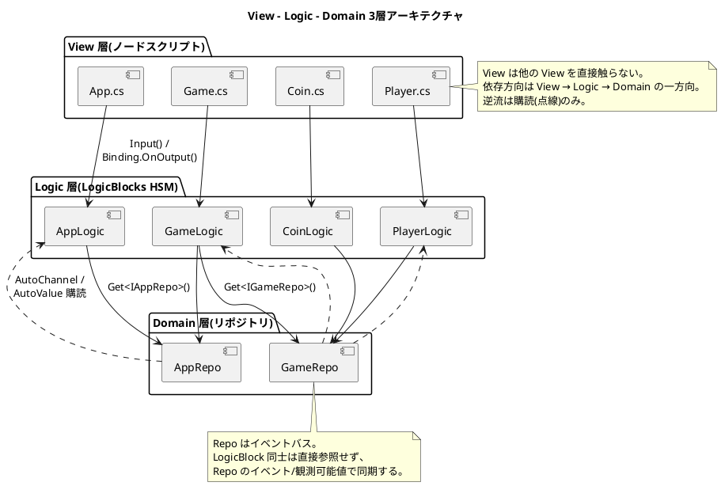
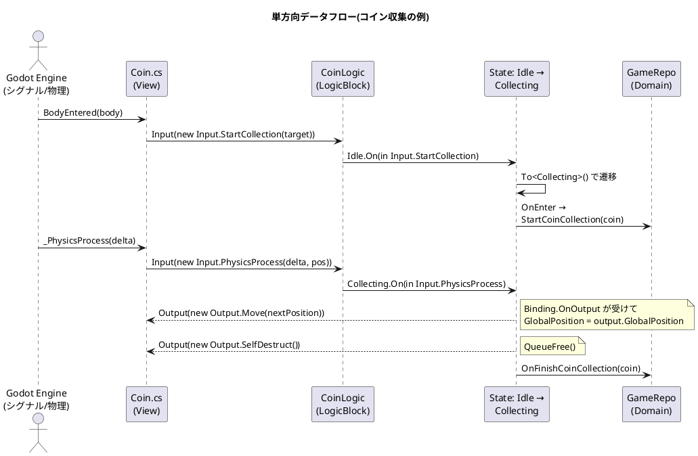
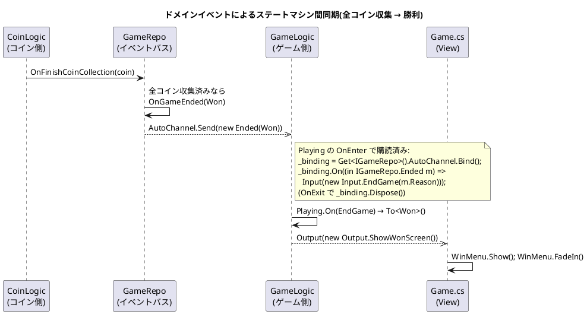
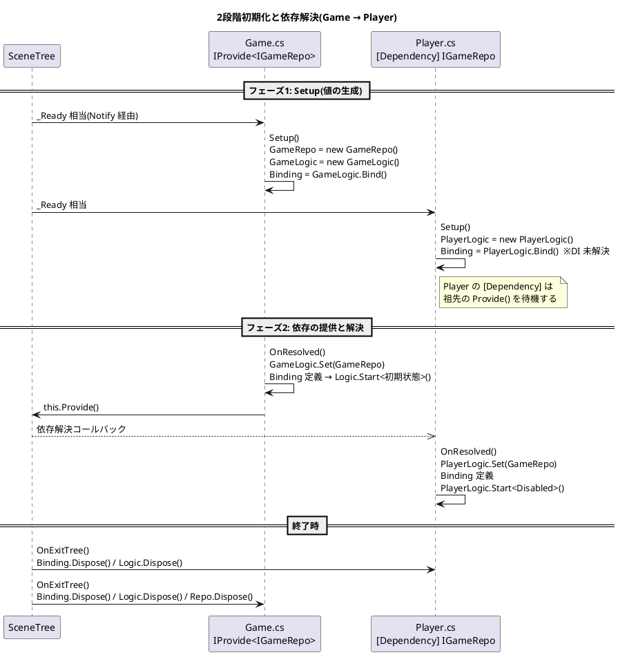
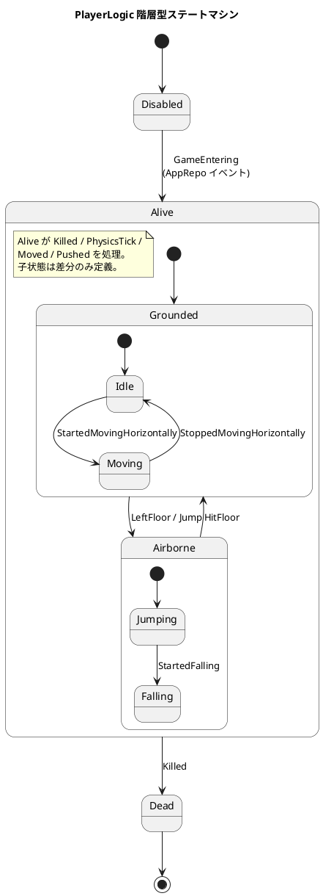

# Chickensoft流 ゲームアーキテクチャ・リファレンス

> **目的**: GameDemo と同じ品質・同じアーキテクチャで別プロジェクトを立ち上げ、進められるようにするための実践リファレンス。
> **出典**: [Chickensoft GameDemo](https://github.com/chickensoft-games/GameDemo)の設計に基づき、本プロジェクトの構成に合わせている。
> 図はすべて PlantUML 形式。コード例は **LogicBlocks 6.2.3 / AutoInject 2.14.18 / Chickensoft.Sync 3.0.1 / Godot 4.7.2** の API に準拠。
> 本プロジェクト固有の書き方(Input/Output を Logic クラス内に置く、全ステートを 1 ファイルにまとめる等)は `CLAUDE.md` の「LogicBlocksパターン」を参照。

---

## 目次

1. [概要と適用範囲](#1-概要と適用範囲)
2. [アーキテクチャ全体図](#2-アーキテクチャ全体図)
3. [ディレクトリテンプレート](#3-ディレクトリテンプレート)
4. [データフロー](#4-データフロー)
5. [初期化ライフサイクルとDI](#5-初期化ライフサイクルとdi)
6. [状態機械設計ガイド](#6-状態機械設計ガイド)
7. [新機能追加の完全な一例(Gem)](#7-新機能追加の完全な一例gem)
8. [セーブ・ロード](#8-セーブロード)
9. [命名規約・スタイル早見表](#9-命名規約スタイル早見表)
10. [テスト戦略](#10-テスト戦略)
11. [ツール・CI チェックリスト](#11-ツールci-チェックリスト)
12. [コードレビューチェックリスト](#12-コードレビューチェックリスト)

---

## 1. 概要と適用範囲

### 前提スタック

| 項目 | 内容 |
| --- | --- |
| エンジン | Godot 4.7.2(C#/.NET 対応ビルド、`global.json` で固定) |
| ランタイム | .NET 8(`Nullable=enable`, `ImplicitUsings=disable`) |
| 状態管理 | Chickensoft.LogicBlocks(階層型ステートマシン) |
| DI | Chickensoft.AutoInject(シーンツリーベース) |
| リアクティブ | Chickensoft.Sync(`AutoValue<T>` / `AutoChannel`) |
| テスト | Chickensoft.GoDotTest + GodotTestDriver + GodotNodeInterfaces + Shouldly + LightMoq(LightMock.Generator) |

### 核となる設計原則(移植時に守るべきこと)

1. **View–Logic–Domain の3層分離** — ノードスクリプト(View)は表示と入出力の転送のみ。判断はすべて LogicBlock(Logic)へ。複数の LogicBlock で共有するロジック・状態は Repo(Domain)へ。
2. **フラグ変数を持たず、状態を列挙する** — 「ロード中」「セーブ中」「ポーズ中」はすべてステートマシンの状態として表現する。bool の組み合わせで状態空間を作らない。
3. **単方向データフロー** — `Input → 状態遷移/Output → View反映`。View から状態を直接書き換える経路を作らない。
4. **すべてにインターフェース** — ノード・Logic・Repo は必ず `I` プレフィックスのインターフェースを持ち、依存は常にインターフェース型で受ける(モック可能性のため)。
5. **一貫性 > 簡潔さ** — ボイラープレートはテスト可能性の代償として受容する。表示しかしないノードにも LogicBlock を作ってよい。「ロジックがあるなら LogicBlock を見ればよい」という予測可能性を守る。

---

## 2. アーキテクチャ全体図



### 各層の責務

| 層 | 実体 | 持つもの | 持たないもの |
| --- | --- | --- | --- |
| View | `Node` 派生 + `[Meta(typeof(IAutoNode))]` | シグナル受信、`Logic.Input()` 転送、`OnOutput` での表示更新、Godot API 呼び出し | 条件分岐によるゲームルール、状態フラグ |
| Logic | `LogicBlock` 派生 + 状態 record 群(`XState : LogicBlockState`) | 状態遷移、ゲームルール、`Output()` 発行、Repo 呼び出し | Godot ノード操作(インターフェース経由の読み取りは可) |
| Domain | POCO(`IDisposable`) | 横断的な状態(`AutoValue`)、ドメインイベント(`AutoChannel`)、純粋ロジック | シーンツリーへの参照、View の知識 |

---

## 3. ディレクトリテンプレート

機能(フィーチャー)単位でシーン・スクリプト・状態機械を同居させる。テストは `test/src/` に置く。

```text
EternalJourney/
├── src/
│   ├── Main.cs / Main.tscn        # エントリポイント(テスト実行判定 → App へ)
│   ├── app/                       # アプリ全体の状態(Splash → Menu → Game)
│   │   ├── App.tscn
│   │   ├── App.cs                 # View
│   │   ├── domain/
│   │   │   └── AppRepo.cs         # ドメインリポジトリ
│   │   └── state/
│   │       ├── AppLogic.cs        # Logic + Input/Output + 全ステート
│   │       └── AppLogic.g.puml    # [StateDiagram] による自動生成
│   ├── game/ battle/ ...          # 機能ごとに同じ構成
│   ├── <entity>/abstract/         # 抽象基底を持つ entity(bullet / weapon / bullet_factory)
│   │   ├── base/                  # 基底クラス
│   │   └── state/{Name}Logic.cs
│   ├── <entity>/strategies/       # JSON 設定で切り替える挙動(movement / collision 等)
│   ├── common/                    # 共通基底・トレイト・状態異常・耐久値モジュール
│   └── cores/                     # 定数・ヘルパー・モデル・プール・設定リーダー
├── data/masters/                  # マスターデータ(JSON / CSV)
├── test/src/                      # GoDotTest のテスト
├── global.json                    # .NET SDK + Godot.NET.Sdk のバージョン固定
└── EternalJourney.csproj
```

### 構成のポイント

- `src/{entity}/state/{Name}Logic.cs` の 1 ファイルに、Logic・Input/Output・全ステートをまとめる。
- フォルダ名は Godot 慣習の `snake_case`、C# ファイル名は型名に合わせて `PascalCase` にする。

---

## 4. データフロー

### 4.1 基本フロー: 入力 → 状態遷移 → 表示反映



### 4.2 Repo イベントバスによる横断同期



### 4.3 データフローのルール

- View → Logic は `Input`(`readonly record struct`)のみ。
- Logic → View は `Output`(`readonly record struct`)のみ。ハンドラは `(in Output.X output) => ...`。
- Logic 同士は直接参照しない。Repo の `AutoChannel`(イベント)/ `AutoValue<T>`(観測可能値)を介す。
- Repo の購読は、それを必要とするステートの `OnEnter` で登録し、`OnExit` で解除する。こうすると、そのステートにいる間だけイベントが届く。
  - `OnEnter` では **購読を先に登録し、その後 `Output`** する。`Output` を受けた View が同期的に Repo イベントを起こすことがあり、購読が後だとその遷移入力を取りこぼす。
  - `OnExit` では **`Output` を先に出し、購読解除は最後** にする。
- `AutoValue<T>` の `Bind().OnValue(cb)` は、登録した時点で現在値を即時に通知する。

---

## 5. 初期化ライフサイクルとDI

AutoInject の 2 段階初期化。**祖先が `IProvide<T>` + `this.Provide()`、子孫が `[Dependency]` + `this.DependOn<T>()`**。シーンツリーの構造がそのまま DI コンテナになる。



### View の定型構造(必ずこの形にする)

```csharp
namespace MyGame;

using Chickensoft.AutoInject;
using Chickensoft.GodotNodeInterfaces;
using Chickensoft.Introspection;
using Chickensoft.LogicBlocks;
using Godot;

public interface IMyFeature : INode3D;

[Meta(typeof(IAutoNode))]
public partial class MyFeature : Node3D, IMyFeature
{
  // AutoInject のライフサイクルを有効化する1行(全ノード共通)
  public override void _Notification(int what) => this.Notify(what);

  #region Nodes
  // 子ノードはインターフェース型 + [Node] で受ける(テストでフェイク可能)
  [Node("%AnimationPlayer")] public IAnimationPlayer AnimationPlayer { get; set; } = default!;
  #endregion Nodes

  #region Dependencies
  [Dependency] public IGameRepo GameRepo => this.DependOn<IGameRepo>();
  #endregion Dependencies

  #region State
  public IMyFeatureLogic Logic { get; set; } = default!;
  public LogicBlock.Binding Binding { get; set; } = default!;
  #endregion State

  // フェーズ1: DI 未解決。自分が所有するものだけを生成する
  public void Setup()
  {
    Logic = new MyFeatureLogic();
    Binding = Logic.Bind();
  }

  // フェーズ2: 依存解決後。Set → Binding 定義 → Start の順
  public void OnResolved()
  {
    Logic.Set(GameRepo);
    Binding.OnOutput((in MyFeatureLogic.Output.DoSomething _) => { /* 表示更新 */ });
    // Start 前に Input() すると LogicBlockException になる
    Logic.Start<MyFeatureState.Idle>();
  }

  // 後始末: イベント購読解除 → Binding → Logic の順で Dispose(自分が生成したものだけ)
  public void OnExitTree()
  {
    Binding.Dispose();
    Logic.Dispose();
  }
}
```

### ライフサイクルメソッドの使い分け

| メソッド | タイミング | やること |
| --- | --- | --- |
| `Setup()` | 依存解決前 | 自分が所有するオブジェクトの生成(Logic・`Bind()`)。DI 依存には触らない |
| `OnReady()` | `_Ready` 相当 | Godot 固有の初期化(`SetPhysicsProcess(true)` 等) |
| `OnResolved()` | `[Dependency]` がすべて解決した後 | 依存の `Logic.Set(...)`、Binding 定義、`this.Provide()`、`Logic.Start<T>()` |
| `OnPhysicsProcess(double)` | 物理ティック | `Logic.Input(new Input.PhysicsTick(delta))` の転送のみ |
| `OnExitTree()` | ツリー離脱時 | イベント購読解除、`Binding.Dispose()`、`Logic.Dispose()`、所有 Repo の `Dispose()` |

---

## 6. 状態機械設計ガイド

### 6.1 階層型ステートマシン(HSM)の設計

共通の振る舞いは親状態に置き、子状態は差分だけを定義する。例:



### 6.2 状態クラスの書き方ルール

- `{Name}Logic.cs` の 1 ファイルに、Logic と全ステートをまとめる。
- 基底ステートは Logic クラスの**外**に `[StateDiagram] public abstract partial record XState : LogicBlockState` として置く。`State` という名前は `LogicBlock.State` プロパティと衝突するので使えない。
- 処理できる入力を `IGet<XLogic.Input.X>` で宣言し、`public Type On(in XLogic.Input.X input)` で遷移先の型を返す。
  - 遷移: `To<NextState>()` / 自己遷移: `ToSelf()`
- 副作用は `this.OnEnter(...)` / `this.OnExit(...)` と `Output(...)` に限定する。
  - `OnEnter` は購読登録を先にし、その後 `Output` する。`OnExit` は `Output` を先にし、購読解除を最後にする(§4.3)。
- ステートのインスタンスは使い回されるため、可変フィールドは `OnEnter` で初期化する。
- 依存はブラックボードから取得: `Get<IGameRepo>()`, `Get<MyLogic.Data>()`, `Get<MyLogic.Settings>()`。
- 状態内から入力を投げ直してよい: `Input(new Input.HitFloor(...))`(物理判定 → 論理イベント変換のパターン)。
- switch 式は必ず網羅し、`_ =>` フォールバックを付ける(未知の enum 値もテストする)。

```csharp
namespace MyGame;

using System;
using Chickensoft.Introspection;
using Chickensoft.LogicBlocks;

[StateDiagram]
public abstract partial record MyFeatureState : LogicBlockState
{
  public record Active : MyFeatureState, IGet<MyFeatureLogic.Input.Deactivated>
  {
    public Active()
    {
      // 購読 → Output の順
      this.OnEnter(() => Get<IGameRepo>().Ended += OnEnded);
      this.OnEnter(() => Output(new MyFeatureLogic.Output.PlayActivateEffect()));
      this.OnExit(() => Get<IGameRepo>().Ended -= OnEnded);
    }

    private void OnEnded() => Input(new MyFeatureLogic.Input.Deactivated());

    public Type On(in MyFeatureLogic.Input.Deactivated input) => To<Inactive>();
  }
}
```

### 6.3 パフォーマンス規約(ゲーム特有)

- LogicBlock のコンストラクタで、全ステートを `Set(new XState.A())` で事前確保する(実行中の GC を避けるため)。
  - **Set していないステートへ遷移すると `KeyNotFoundException`**(`Data of type ... not found in the blackboard`)になる。ステートを追加したら ctor への追加を忘れない。
  - 遷移前にステートへ値を渡すときは、`Get<NextState>()` で取り出してプロパティを設定してから `To<NextState>()` する(実例: `src/bullet/abstract/state/BulletLogic.cs` の EmitWait → InFlight)。
- `Input` / `Output` は `readonly record struct` にし、ハンドラは `in` 引数で受ける(ボックス化・コピー回避)。
- ホットパスの小さな述語には `[MethodImpl(MethodImplOptions.AggressiveInlining)]` を検討する。

---

## 7. 新機能追加の完全な一例(Gem)

「プレイヤーが触れると吸い寄せられて消える宝石(Gem)」を追加する場合の**最小フルセット**。

### 7.1 追加するファイル一覧

```text
src/gem/
├── Gem.tscn
├── Gem.cs                  # View
└── state/
    ├── GemLogic.cs         # LogicBlock 本体 + Input/Output + Data/Settings + GemState
    └── GemState.g.puml     # [StateDiagram] による自動生成(手動編集禁止)
test/src/gem/
└── GemTest.cs              # View / Logic テスト
```

### 7.2 LogicBlock 本体 — `state/GemLogic.cs`

```csharp
namespace MyGame;

using System;
using Chickensoft.Introspection;
using Chickensoft.LogicBlocks;
using Godot;

public interface IGemLogic : ILogicBlock;

[Meta]
public partial class GemLogic : LogicBlock, IGemLogic
{
  public GemLogic()
  {
    // 全ステートを事前確保(Set 漏れは遷移時に KeyNotFoundException)
    Set(new GemState.Idle());
    Set(new GemState.Collecting());
  }

  // 状態から Get<GemLogic.Settings>() で参照する不変設定
  public record Settings(double CollectionTimeInSeconds);

  // 状態から Get<GemLogic.Data>() で参照する可変データ
  public class Data
  {
    public ICoinCollector? Target { get; set; }
    public double ElapsedTime { get; set; }
  }

  public static class Input
  {
    public readonly record struct StartCollection(ICoinCollector Target);
    public readonly record struct PhysicsProcess(
      double Delta, Vector3 GlobalPosition
    );
  }

  public static class Output
  {
    public readonly record struct Move(Vector3 GlobalPosition);
    public readonly record struct SelfDestruct;
  }
}
```

### 7.3 ステート — 同じ `state/GemLogic.cs` 内

```csharp
[StateDiagram]
public abstract partial record GemState : LogicBlockState
{
  public record Idle : GemState, IGet<GemLogic.Input.StartCollection>
  {
    public Type On(in GemLogic.Input.StartCollection input)
    {
      Get<GemLogic.Data>().Target = input.Target;
      return To<Collecting>();
    }
  }

  public record Collecting : GemState, IGet<GemLogic.Input.PhysicsProcess>
  {
    public Collecting()
    {
      // 副作用は OnEnter に集約する。ドメインへの通知もここから行う。
      // ※ IGameRepo に対応するメソッド(StartGemCollection 等)を追加すること。
      this.OnEnter(() =>
      {
        // インスタンスは使い回されるので、可変値はここで初期化する
        Get<GemLogic.Data>().ElapsedTime = 0;
        Get<IGameRepo>().StartGemCollection(Get<IGem>());
      });
    }

    public Type On(in GemLogic.Input.PhysicsProcess input)
    {
      var settings = Get<GemLogic.Settings>();
      var data = Get<GemLogic.Data>();

      data.ElapsedTime += input.Delta;

      if (data.ElapsedTime >= settings.CollectionTimeInSeconds)
      {
        Output(new GemLogic.Output.SelfDestruct());
      }

      if (data.Target is { } target)
      {
        var nextPosition = input.GlobalPosition.Lerp(
          target.CenterOfMass,
          (float)(data.ElapsedTime / settings.CollectionTimeInSeconds)
        );
        Output(new GemLogic.Output.Move(nextPosition));
      }

      return ToSelf();
    }
  }
}
```

### 7.4 View — `Gem.cs`

```csharp
namespace MyGame;

using Chickensoft.AutoInject;
using Chickensoft.GodotNodeInterfaces;
using Chickensoft.Introspection;
using Chickensoft.LogicBlocks;
using Godot;

public interface IGem : INode3D
{
  IGemLogic GemLogic { get; }
}

[Meta(typeof(IAutoNode))]
public partial class Gem : Node3D, IGem
{
  public override void _Notification(int what) => this.Notify(what);

  #region Exports
  public double CollectionTimeInSeconds { get; set; } = 1.0f;
  #endregion Exports

  #region Nodes
  [Node("%AnimationPlayer")] public IAnimationPlayer AnimationPlayer { get; set; } = default!;
  #endregion Nodes

  #region Dependencies
  [Dependency] public IGameRepo GameRepo => this.DependOn<IGameRepo>();
  #endregion Dependencies

  #region State
  public IGemLogic GemLogic { get; set; } = default!;
  public LogicBlock.Binding GemBinding { get; set; } = default!;
  #endregion State

  // DI 未解決: 自分が所有するものだけを生成する
  public void Setup()
  {
    GemLogic = new GemLogic();
    GemBinding = GemLogic.Bind();
  }

  // DI 解決済み: 依存を Set → Binding 定義 → Start
  public void OnResolved()
  {
    GemLogic.Set(this as IGem);
    GemLogic.Set(new GemLogic.Settings(CollectionTimeInSeconds));
    GemLogic.Set(new GemLogic.Data());
    GemLogic.Set(GameRepo);

    GemBinding
      .OnState<GemState.Collecting>(_ =>
      {
        SetPhysicsProcess(true);
        AnimationPlayer.Play("collect");
      })
      .OnOutput((in GemLogic.Output.Move output) =>
        GlobalPosition = output.GlobalPosition)
      .OnOutput((in GemLogic.Output.SelfDestruct _) => QueueFree());

    GemLogic.Start<GemState.Idle>();
  }

  public void OnPhysicsProcess(double delta) =>
    GemLogic.Input(new GemLogic.Input.PhysicsProcess(delta, GlobalPosition));

  public void OnCollectorBodyEntered(Node body)
  {
    if (body is ICoinCollector target)
    {
      GemLogic.Input(new GemLogic.Input.StartCollection(target));
    }
  }

  public void OnExitTree()
  {
    GemBinding.Dispose();
    GemLogic.Dispose();
  }
}
```

### 7.5 チェック: 新機能追加の手順まとめ

1. `src/<feature>/` を作り、View と `state/{Feature}Logic.cs`(Logic + Input/Output + ステート)を上記テンプレートで揃える
2. Logic の ctor で全ステートを `Set(new XState.A())` で事前確保する
3. 依存(Repo 等)は `[Dependency]` で受け、`OnResolved()` で `Logic.Set(...)` する(`Setup()` は DI 未解決)
4. `test/src/<feature>/` にテストを追加する(→ §10)
5. `dotnet build` で警告が増えていないことと、`.g.puml` が再生成されることを確認する

---

## 8. セーブ・ロード

本プロジェクトはセーブ機能が未実装。実装するときは以下に従う。

- ステートマシンの再開には `Logic.Start(LogicBlockData)` を使う。
- 非同期のセーブ・ロード中は、入力をブロックするステートに遷移させる(例: `Saving` / `LoadingSaveFile`)。完了は `Input(new Input.SaveCompleted())` で通知する。**ローディングフラグ変数は作らない**。
- セーブファイルがないことは正常系として扱う(ログ出力 + null 返却)。
- ファイル I/O はインターフェース経由にし、テストでフェイクに差し替えられるようにする。

---

## 9. 命名規約・スタイル早見表

Microsoft 公式規約から**意図的に逸脱**している箇所があるので注意(.editorconfig に明記)。

| 対象 | 規約 | 例 |
| --- | --- | --- |
| 型・メソッド・プロパティ・公開フィールド | `PascalCase` | `PlayerLogic`, `OnResolved` |
| private フィールド | `_camelCase` | `_autoChannel`, `_disposedValue` |
| 定数 | `ALL_UPPER_SNAKE` | `GAME_SCENE_PATH`, `SAVE_FILE_NAME` |
| インターフェース | `I` プレフィックス必須(全ノード・Repo・Logic) | `IGameRepo`, `ICoin` |
| ジェネリック型引数 | `T` プレフィックス | `TState` |
| Input/Output メッセージ | `readonly record struct`、名は出来事/命令 | `Input.Jumped`, `Output.MovementComputed` |
| Repo の通知メソッド | `On<出来事>` / 設定系は `Set<値>` | `OnGameEnded`, `SetIsMouseCaptured` |
| ファイル名 | 型名と一致。入れ子はドット区切り | `PlayerLogic.State.Alive.cs` |
| フォルダ名 | `snake_case`(Godot 慣習) | `in_game_ui/` |
| テストクラス | `<対象>Test`、`test/src/` にミラー配置 | `PlayingTest.cs` |

### スタイル・イディオム

- file-scoped namespace(`namespace MyGame;`)、`using` は **namespace の内側**、System を先頭にソート。
- インデント 2 スペース、80 桁ルーラー、LF、`var` 全面使用、1 行に収まるメンバは式形式(`=>`)。
- ブレース必須(1 行 if 禁止)。プライマリコンストラクタ禁止(ツール対応不良のため)。
- DI・ライフサイクルで後から必ず代入されるプロパティは `= default!` で宣言。
- `#region` は定型区分に限定: `Nodes` / `Exports` / `State` / `Save` / `Dependencies` / `Provisions` / `Internals`。
- コメントは「**なぜ**」を書く(バグ回避・設計判断の理由)。公開 API には単位付きの XML ドキュメントコメント(`/// <summary>Rotation speed (quaternions?/sec).</summary>`)。
- switch 式は網羅必須 + `_ =>` フォールバック。switch 文より switch 式を優先。

---

## 10. テスト戦略

**すべてのクラスに対応するテストを書く**(カバレッジバッジを README に掲示するのが Chickensoft 流)。テストは 2 種類に大別される。

### 10.1 Logic テスト(純粋・高速)

実際の LogicBlock を生成し、ブラックボードにフェイク依存を `Set` してから `Start<T>()` → `Input()` → `State` / Output を検証する。

```csharp
namespace MyGame.Tests;

using Chickensoft.GoDotTest;
using Chickensoft.LogicBlocks;
using Godot;

public class GemLogicTest : TestClass
{
  private GemLogic _logic = default!;
  private LogicBlock.Binding _binding = default!;
  private GemLogic.Data _data = default!;

  public GemLogicTest(Node testScene) : base(testScene) { }

  [Setup]
  public void Setup()
  {
    _logic = new GemLogic();
    _data = new GemLogic.Data();
    _logic.Set(_data);                         // ブラックボードへ依存を注入
    _logic.Set(new GemLogic.Settings(1.0));
    _logic.Set<IGameRepo>(new FakeGameRepo()); // 手書きフェイク
    _binding = _logic.Bind();
  }

  [Cleanup]
  public void Cleanup()
  {
    _binding.Dispose();
    _logic.Dispose();
  }

  [Test]
  public void StartsCollectingOnStartCollection()
  {
    _logic.Start<GemState.Idle>();
    _logic.Input(new GemLogic.Input.StartCollection(new FakeCollector()));

    // 遷移先ステートと Data の変化を検証
    if (_logic.State is not GemState.Collecting)
    {
      throw new System.Exception("Collecting に遷移していない");
    }
  }
}
```

検証ポイント:

- 遷移後の `_logic.State` の型
- `_binding.OnOutput((in GemLogic.Output.X o) => ...)` で受け取った Output
- フェイク Repo に記録された呼び出し(購読・解除の対称性も含む)

### 10.2 View テスト — フェイク注入 + `FakeBinding`

ノードを `new` して、`IsTesting = true` で `Setup()` をスキップし、全依存をフェイクに差し替える。

```csharp
[Setup]
public void Setup()
{
  _logic = new Mock<IGemLogic>();
  _binding = LogicBlock.CreateFakeBinding();
  _logic.Setup(logic => logic.Bind()).Returns(_binding);

  _gem = new Gem
  {
    AnimationPlayer = _animPlayer.Object,
    GemLogic = _logic.Object,
    GemBinding = _binding
  };

  (_gem as IAutoInit).IsTesting = true;       // Setup() フェーズをスキップ
  _gem.FakeDependency(_gameRepo.Object);       // [Dependency] をフェイク
  _gem.FakeNodeTree(new()                      // [Node] をフェイク
  {
    ["%AnimationPlayer"] = _animPlayer.Object
  });
}

[Test]
public void MovesOnMoveOutput()
{
  _gem.OnResolved();
  _binding.Output(new GemLogic.Output.Move(Vector3.One)); // 出力を偽装
  _gem.GlobalPosition.ShouldBe(Vector3.One);
}
```

- 実シーンツリーが必要なテストのみ `GodotTestDriver` の `Fixture` で `await fixture.AddToRoot(node)`。
- 入力転送の検証は `_logic.Setup(l => l.Input(in It.Ref<Input.X>.IsAny))` + `VerifyAll()`。
- Repo フェイクの `IAutoValue<T>` プロパティは実物の `AutoValue<T>` を返し、`[Cleanup]` で `Dispose()` する。
- `LogicBlock.CreateFakeBinding()` で `Output` / `Input` / `SetState` / `EnterState` / `ExitState` / `Start` / `Stop` を偽装できる。

### 10.3 テスト実行の仕組み

- エントリポイント `Main.cs` が `RUN_TESTS` define(Debug ビルドのみ)+ コマンドライン引数で判定し、GoDotTest を起動する。**同一バイナリでゲームもテストも動く**。
- リリースビルドでは csproj の条件で `test/**` のコンパイルとテスト用パッケージ参照が完全に除外される。

---

## 11. ツール・CI チェックリスト

新プロジェクト立ち上げ時に揃えるもの。[Chickensoft GodotGame テンプレート](https://github.com/chickensoft-games/GodotGame)から生成するのが最短。

### .editorconfig(コード品質の門番)

- [ ] Chickensoft EditorConfig をベースにする
- [ ] `dotnet_analyzer_diagnostic.severity = warning` — **全スタイルルールをデフォルト warning 化**
- [ ] ルールを無効化するときは必ず理由コメントを添える(既存の無効化例: プライマリコンストラクタ禁止、switch 文の網羅不要・switch 式は網羅必須)

### csproj

- [ ] `<Nullable>enable</Nullable>` / `<ImplicitUsings>disable</ImplicitUsings>`
- [ ] `<WarningsAsErrors>CS9057</WarningsAsErrors>`(ソースジェネレータのコンパイラ不整合を即エラー)
- [ ] `<EmitCompilerGeneratedFiles>true</EmitCompilerGeneratedFiles>` + `.generated/` で生成コードを可視化
- [ ] テスト依存は `RUN_TESTS` 条件付き `ItemGroup`、リリース時に `<Compile Remove="test/**/*.cs" />`
- [ ] `CodeAnalyzers.ruleset` で遅いアナライザ(RS1022, CA2252)のみ無効化
- [ ] `global.json` で .NET SDK と `Godot.NET.Sdk` のバージョンを固定

### CI(GitHub Actions)

- [ ] **実 Godot ランタイムでのテスト実行**: `xvfb-run godot --headless 相当 + --run-tests --quit-on-finish`、mesa エミュレーションドライバでレンダードライバを matrix 化
- [ ] スペルチェック(cspell + `cspell.json` の辞書管理)
- [ ] バージョン更新の workflow_dispatch → 自動 PR 生成
- [ ] renovate による依存自動更新(Godot バージョンは `global.json` を単一ソースにする)

### カバレッジ

- [ ] coverlet + reportgenerator(`coverage.ps1` / `coverage.sh`)
- [ ] バッジ SVG を `badges/` にコミットし README から参照
- [ ] 生成物ディレクトリ(`docs/`, `coverage/`, `badges/`)に `.gdignore` を置いて Godot から隠す

### エディタ

- [ ] VSCode: `formatOnSave` + `organizeImports` + `fixAll`、80 桁ルーラー
- [ ] launch.json にテストデバッグ用プロファイル(GoDotTest が VSCode デバッグに対応)

---

## 12. コードレビューチェックリスト

このアーキテクチャ基準でのレビュー観点(全項目がプロジェクト内の実例に基づく):

- [ ] **View にロジックがないか** — 条件分岐・ルール判定が View にあれば LogicBlock へ移す
- [ ] **新しい状態はセットが揃っているか** — Logic の ctor で `Set(new XState.X())` されているか(漏れると遷移時に `KeyNotFoundException`)/ `IGet<>` 宣言 / 対応するテスト
- [ ] **OnEnter / OnExit の順序** — `OnEnter` は購読 → Output、`OnExit` は Output → 購読解除の順か。再利用されるステートの可変フィールドを `OnEnter` で初期化しているか
- [ ] **Start 前 Input** — `Logic.Start<T>()` より前に `Input()` していないか(`LogicBlockException`)
- [ ] **依存の受け方** — 子ノードは `[Node]` + インターフェース型、祖先依存は `[Dependency]` + `IProvide` + `this.Provide()`
- [ ] **メッセージ型** — Input/Output は `readonly record struct`、ハンドラは `in` 引数
- [ ] **後始末** — `OnExitTree()` でシグナル購読解除・`Binding.Dispose()`・`Logic.Dispose()`・所有 Repo の `Dispose()` が揃っているか。`AutoValue` の Binding と値本体の両方を Dispose しているか
- [ ] **命名** — 定数 `ALL_UPPER`、private `_camelCase`、インターフェース `I` プレフィックス
- [ ] **switch 式** — 網羅 + `_ =>` フォールバックがあるか(未知の enum 値のテストも)
- [ ] **状態 vs フラグ** — 新しい bool フラグが実は「状態」ではないか(ローディング・処理中は state にする)
- [ ] **Logic 間の直接参照がないか** — ステートマシン間の連携は Repo のイベント/観測可能値を経由しているか

---

## 付録: 最小限の Repo テンプレート

```csharp
namespace MyGame;

using System;
using Chickensoft.Sync.Primitives;

public interface IScoreRepo : IDisposable
{
  IAutoChannel AutoChannel { get; }

  /// <summary>Event invoked when a high score is reached.</summary>
  readonly record struct HighScoreReached(int Score);

  /// <summary>Current score.</summary>
  IAutoValue<int> Score { get; }

  void AddScore(int amount);
}

public class ScoreRepo : IScoreRepo
{
  private readonly AutoChannel _autoChannel = new();
  public IAutoChannel AutoChannel => _autoChannel;

  public IAutoValue<int> Score => _score;
  private readonly AutoValue<int> _score = new(0);

  private bool _disposedValue;

  public void AddScore(int amount)
  {
    _score.Value += amount;

    if (_score.Value >= 100)
    {
      _autoChannel.Send(new IScoreRepo.HighScoreReached(_score.Value));
    }
  }

  #region Internals

  protected void Dispose(bool disposing)
  {
    if (!_disposedValue)
    {
      if (disposing)
      {
        _score.Dispose();
        _autoChannel.Dispose();
      }

      _disposedValue = true;
    }
  }

  public void Dispose()
  {
    Dispose(disposing: true);
    GC.SuppressFinalize(this);
  }

  #endregion Internals
}
```

LogicBlock 側での購読(購読が必要なステートの `OnEnter` で登録し、`OnExit` で `Dispose` する):

```csharp
public record Playing : MyState, IGet<MyLogic.Input.HighScore>
{
  private AutoValue<int>.Binding? _scoreBinding;
  private AutoChannel.Binding? _channelBinding;

  public Playing()
  {
    this.OnEnter(() =>
    {
      var repo = Get<IScoreRepo>();
      // AutoValue: 登録時に現在値が即時通知される
      _scoreBinding = repo.Score.Bind();
      _scoreBinding.OnValue(score => Output(new MyLogic.Output.ScoreChanged(score)));

      _channelBinding = repo.AutoChannel.Bind();
      _channelBinding.On((in IScoreRepo.HighScoreReached m) =>
        Input(new MyLogic.Input.HighScore(m.Score)));
    });
    // 購読解除は OnExit の最後に
    this.OnExit(() =>
    {
      _scoreBinding?.Dispose();
      _scoreBinding = null;
      _channelBinding?.Dispose();
      _channelBinding = null;
    });
  }

  public Type On(in MyLogic.Input.HighScore input) => To<Celebrating>();
}
```

実例: `src/battle_ui/state/BattleUILogic.cs`(`Active` ステートの `_scoreBinding`)。
